# Frisør — Next.js Barbershop & Apothecary Booking Template

A production-ready booking website for modern barbershops. Built with **Next.js 15**, **Tailwind CSS v4**, and the **Opencals Storefront SDK**.

**[View Live Demo →](https://template-frisor-sage.vercel.app)**

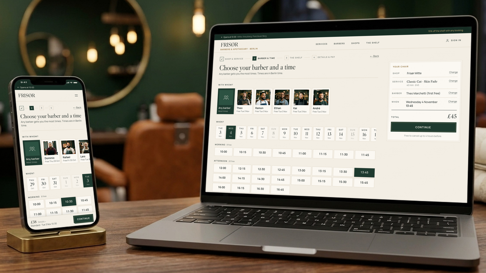

Frisør is a premium Berlin barbershop with three shops, thirteen barbers and an apothecary shelf. Warm paper, bottle green and brass, big editorial photography, Libre Caslon and Manrope. The booking flow is deliberately classic: three short steps with your appointment and the total always in view, and the shop's retail products sold as part of the booking and picked up at the chair. MIT licensed: clone it, rebrand it, ship it.

---

## Get Started in 3 Steps

### 1. Create an Opencals account

Sign up at **[app.opencals.com](https://app.opencals.com)** and create a **Dev Store** in **Germany (EUR)**. When prompted for a dataset, choose **Frisør (barbershop)**. It seeds the three shops, thirteen barbers, the services, twelve shelf products (add-ons with the slug prefix `shelf-`) and the codes `SHELF15` and `FIRSTCHAIR`.

### 2. Get your API key

Go to your **User Account Settings** in the Opencals dashboard and generate a **private storefront key** (`spk_`). The template calls the API from its server, so the key stays secret, and it forwards each visitor's IP (`nextBuyerIp` in `lib/opencals.ts`) so visitors get their own rate limits. If your server has fixed outgoing IPs you can restrict the key to them; on Vercel, leave the list empty. A public key (`sfk_`) also works, but then all visitors share your server's limits.

### 3. Deploy to Vercel

[](https://vercel.com/new/clone?repository-url=https%3A%2F%2Fgithub.com%2Fletsopencals%2Ftemplate-frisor&env=OPENCALS_API_KEY,AUTH_SECRET&envDescription=API%20key%20from%20your%20Opencals%20dashboard%20and%20a%20random%20secret%20for%20auth&project-name=frisor&repository-name=frisor)

| Variable | Value |
|----------|-------|
| `OPENCALS_API_KEY` | Your private storefront key (starts with `spk_`) |
| `AUTH_SECRET` | Any random string, used for session encryption |
| `NEXT_PUBLIC_STRIPE_PUBLISHABLE_KEY` | *(optional)* Stripe publishable key for card payments |

---

## The booking flow

Three steps, each one screen. **Your chair** (shop, service, barber, time, extras and the running total, with the Continue button) is a sticky panel on desktop and a bar at the bottom on phones, so the next action is always in view.

1. **Shop & service.** The shops as tabs, then that shop's menu. Services with options (Standard, Skin Fade, Scissor Cut) open inline; choosing one moves on.
2. **Barber & time.** Barber portraits with "Any barber" first, then the date strip directly above the day's free times, grouped Morning / Afternoon / Evening.
3. **The Shelf.** Products that pair with the service first, in-chair extras, and "Skip the shelf". Anything added is packed and waiting at the station, and `SHELF15` (15% off retail) goes on by itself.

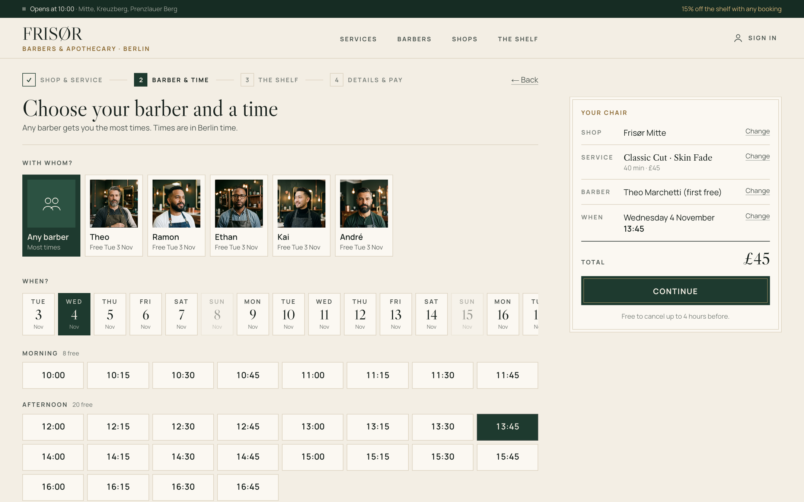

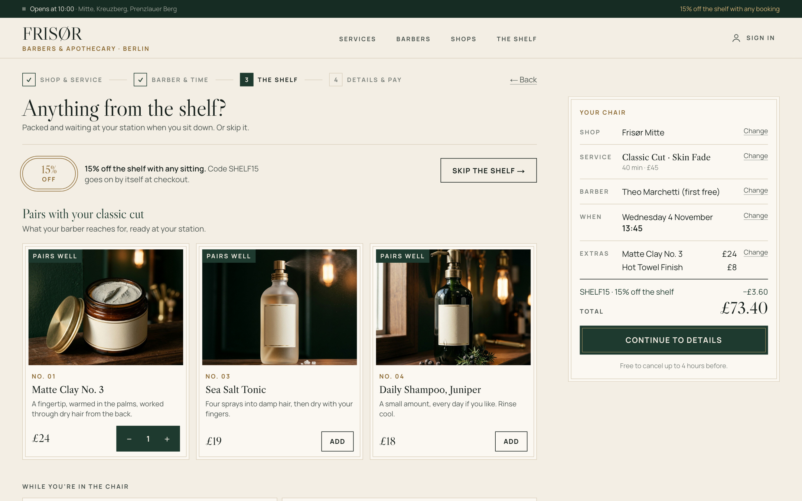

Availability is one cached server request per service and shop across the whole booking window (`app/api/availability/studio`); days and times are derived in the browser.

## Checkout

Contact details and payment on one page (sign in with an emailed code, or just type your email), with the order on the side as a house receipt: each appointment, the shelf products with steppers, a last-call row of two products, the discount-code field and the totals.

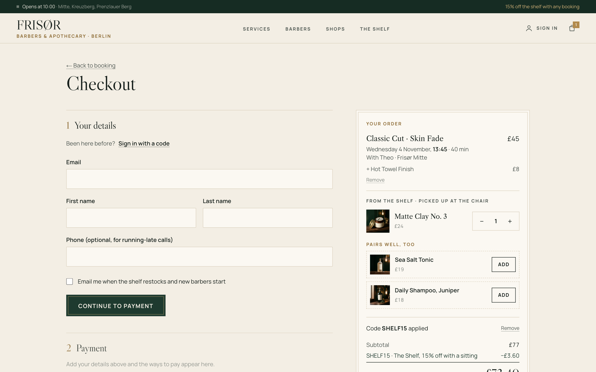

## After booking

The confirmation is an **appointment label** in the apothecary style, beside a plain list of the facts (when, where, barber, what's set aside at the chair, what to pay), with Add to calendar, Directions and Manage booking, then "Restock at your next visit" and "Book the next one".

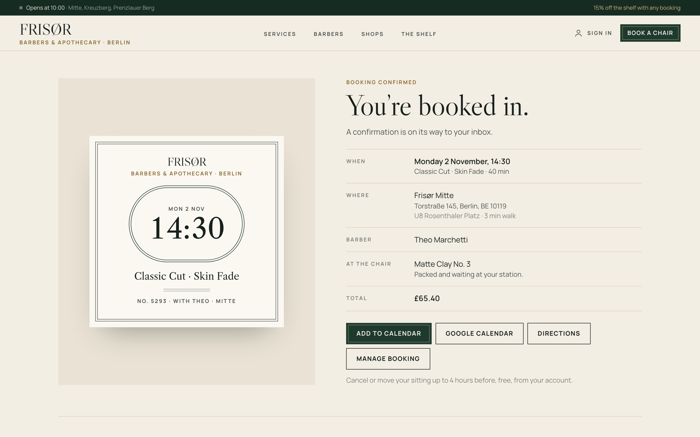

The account shows the next visit, past visits with **Book again**, "Your shelf" restock links, orders with receipts, and move/cancel within the shop's notice period.

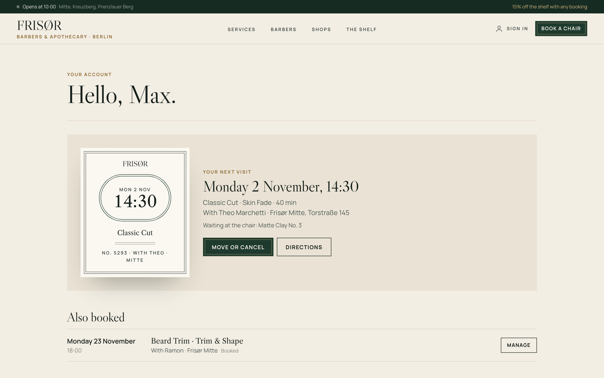

## The storefront

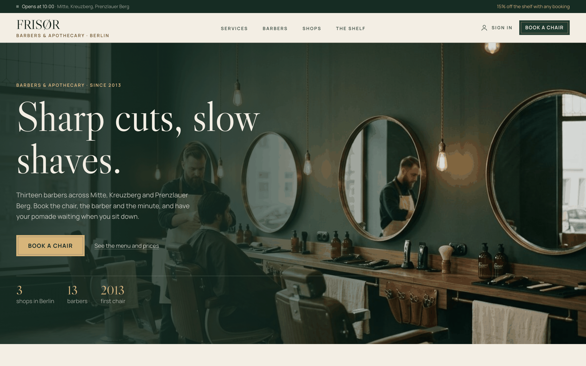

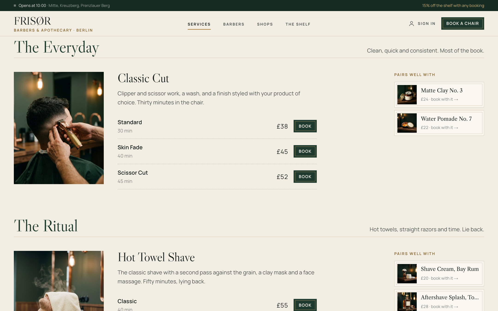

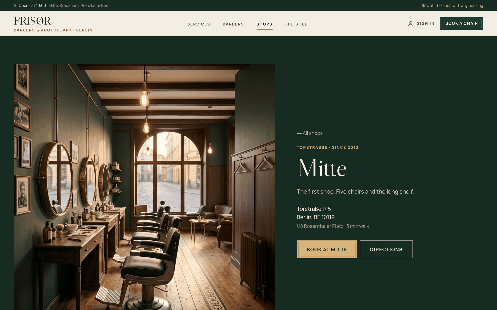

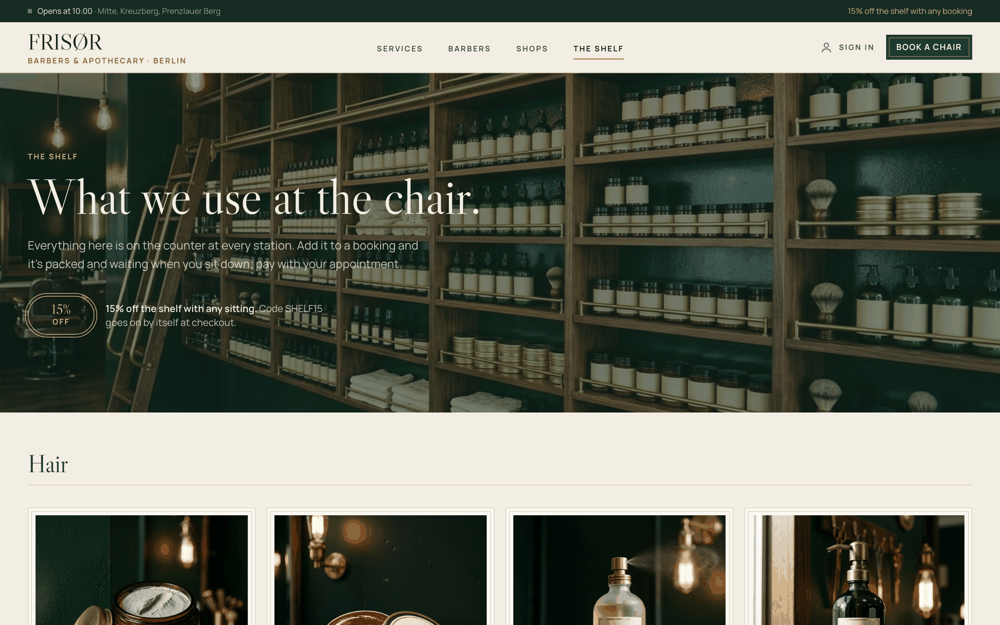

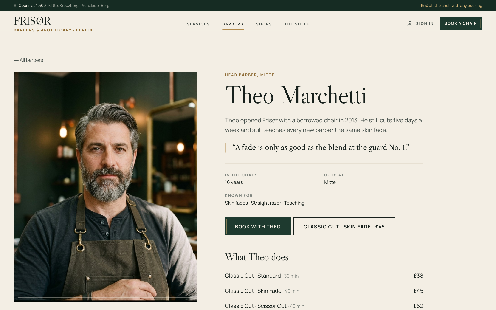

On a phone:

<p>
  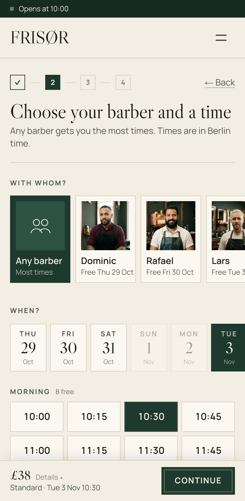
  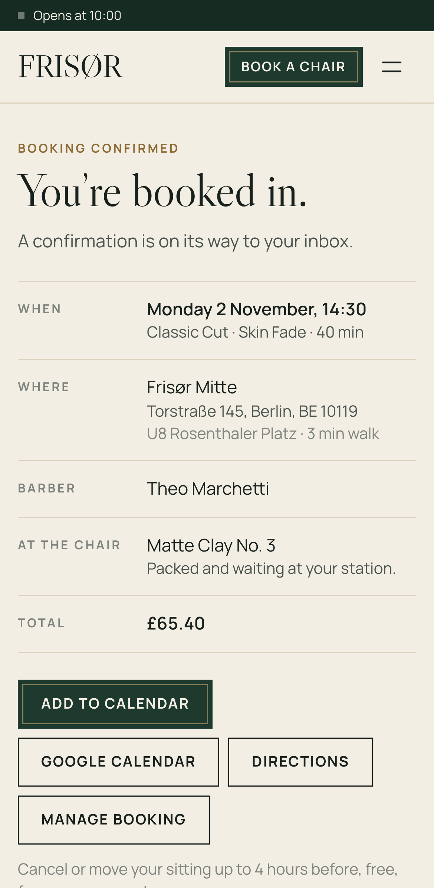
</p>

`/preview/thank-you` and `/preview/account` render the post-booking screens with sample data from your own store, for design work without making bookings.

---

## Selling retail with a booking

The Storefront API has no separate retail checkout, so the shelf is modelled as **add-ons**: any add-on whose slug starts with `shelf-` (`siteConfig.shelf.prefix`) is a product you pick up at the chair. They're offered in booking step 3, at checkout, on service pages ("pairs well with"), on barber pages ("what Theo uses"), on `/shelf` and on the thank-you and account pages ("restock at your next visit" links to `/book?kit=<slugs>`). Names, prices and photos come from the store; the pairings and how-to notes live in `lib/site-config.ts`.

---

## Customization

- **Copy and the editorial layer:** `lib/site-config.ts` (shop notes, barber bios, shelf notes and pairings, hours, policies). Everything bookable comes from the store.
- **Design tokens:** `app/globals.css` (`@theme`: paper, ink, green, brass; `.btn`, `.field`, `.choice`, `.apoth` classes). Read `DESIGN.md` before changing the UI.
- **Fonts:** `app/layout.tsx` (Libre Caslon Display, Libre Caslon Text, Manrope via `next/font`).

## Project Structure

```
app/
  page.tsx                 # Home
  services/ barbers/ shops/ shelf/
  book/                    # Three-step booking
  checkout/ thank-you/
  account/                 # Visits, visit detail (move/cancel), orders, profile
  auth/ link/[token]/      # Code sign-in, password, magic links
  preview/[screen]/        # Post-booking screens with sample data
  api/                     # Server routes that call the SDK
components/
  site/ home/ services/ barbers/ shops/ shelf/
  book/ checkout/ confirmation/ account/ auth/ ui/
contexts/ hooks/ lib/      # cart, checkout, availability, catalogue, auth
```

## Local Development

```bash
git clone https://github.com/letsopencals/template-frisor.git
cd template-frisor
npm install
cp .env.example .env.local   # OPENCALS_API_KEY, AUTH_SECRET
npm run dev
```

## Environment Variables

| Variable | Required | Description |
|----------|----------|-------------|
| `OPENCALS_API_KEY` | Yes | Private storefront key (`spk_`) from your Opencals dashboard |
| `AUTH_SECRET` | Yes | Random string for NextAuth session encryption |
| `NEXT_PUBLIC_STRIPE_PUBLISHABLE_KEY` | No | Stripe publishable key for payment processing |
| `OPENCALS_API_URL` | No | Override API base URL (defaults to production) |
| `NEXT_PUBLIC_BASE_URL` | No | Public site URL (for sitemap) |

---

## Other Templates

Frisor is one of the open-source booking templates built on the Opencals Storefront SDK. Same backend, different design and vertical:

- **[HAAR](https://github.com/letsopencals/template-haar)** — a hair-salon booking template with a light, warm palette. [Live demo](https://template-haar.vercel.app)
- **[NOIR Drive](https://github.com/letsopencals/template-noir)** — a luxury car-rental template (Dubai) with multi-day booking by the day and chauffeur packages. [Live demo](https://template-noir.vercel.app)
- **[Fluently](https://github.com/letsopencals/template-fluently)** — a language-school template (New York) with group classes, live seats, private lessons and online lessons. [Live demo](https://template-fluently.vercel.app)
- **[Bali Villa Rentals](https://github.com/letsopencals/template-bali-villas)** — a villa-rental template (Bali, demo brand Lumbung Sidemen) with nightly stays and fixed check-in and check-out. [Live demo](https://template-bali-villas.vercel.app)
- **[Tensile](https://github.com/letsopencals/template-reformer)** — a reformer Pilates studio template (Berlin) with a multi-studio class timetable, beds left, privates and workshops. [Live demo](https://template-reformer.vercel.app)
- **[Alba Dental](https://github.com/letsopencals/template-alba)** — a dental group template (London) with five studios, a Smile Check on a tooth chart, a chair-time booking planner and a cut-paper kids site. [Live demo](https://template-alba.vercel.app)

See all templates and the Storefront API at **[opencals.com/developers](https://opencals.com/developers)**.

## Build with AI

Prefer to let an AI agent do the heavy lifting? Install the **[Opencals Agent Skills](https://github.com/letsopencals/skills)** in Claude Code, Cursor, Codex or Gemini CLI:

- **`opencals-build-booking-site`** — scaffold, wire and deploy a template like this one
- **`opencals-storefront-api`** — ground-truth reference for the Opencals API & SDK

Docs: **[opencals.com/docs → AI Agents](https://opencals.com/docs/ai-agents/overview)**.

## License

MIT
